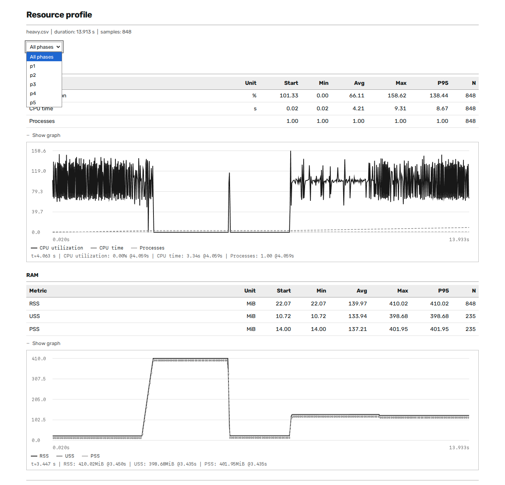
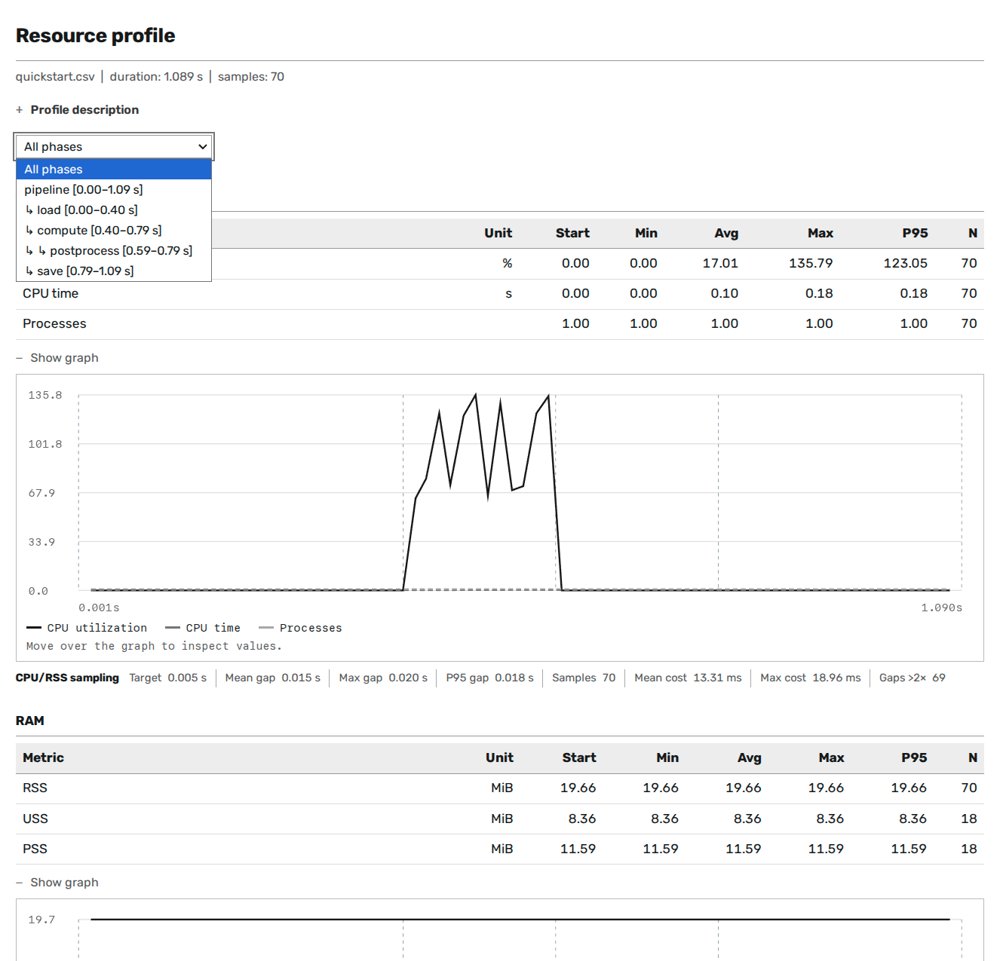

# nprof -- naive profiler
Latest release: 0.6.1  

`nprof` is a statistical Python profiler that tracks resource usage by a process and its child processes: CPU, RAM, and GPU.  
`nprof` is not a function-level profiler: it measures resource consumption over time rather than Python function calls or individual lines of code.  

It produces raw `.csv` and `.json` files, or formatted `.txt`, `.md`, and [.html](#examples) reports.

## Installation

Python 3.9+:

```bash
# Download the .whl file from Releases
uv add ./nprof-0.3.0-py3-none-any.whl
# List GPUs available for profiling. Windows supports NVIDIA only;
# Linux also supports Intel.
uv run nprof gpus
```

## Dependencies

`psutil`, `nvidia-ml-py`  
For Intel GPU metrics on Linux, `intel_gpu_top` must be installed on the system. GPU monitoring can also be disabled entirely with `gpu="none"`.

## Quick start

```python
# You can find this code in examples/quickstart.py
import time

from nprof import phase, profiling_start, profiling_stop, start, stop

profiling_start(
    output="out/quickstart",
    interval=0.005,         # CPU + RSS: 5 ms
    memory_interval=0.05,   # USS + PSS: 50 ms
    gpu_interval=0.1,       # GPU:       100 ms
    gpu="none",             # Try "auto" to use the first available GPU
    include_children=True,
    sampler="process",      # "thread" is also supported, but "process" is strongly recommended
    html=True,
    description="## Quick start. Include driver and software versions, test parameters, date and time, etc. here.",
)

try:
    start()                         # Start of the interval of interest
    try:
        with phase("pipeline"):     # Phases are inclusive: they include nested intervals
            with phase("load"):
                time.sleep(0.4)
            with phase("compute"):
                result = sum(i*i for i in range(4_000_000))
                with phase("postprocess"):
                    time.sleep(0.2)
            with phase("save"):
                time.sleep(0.3)
    finally:
        stop()                       # End of the interval
finally:
    report = profiling_stop()        # Stop the sampler and write the reports

print(report["selection"]["duration_s"])
print(report["phase_summaries"]["pipeline"]["metrics"]["rss_mib"]["max"])
```

This creates `quickstart.csv`, `.txt`, and [.html](#examples) files.  
The `.html` report is fully self-contained and includes easy-to-read charts. You can view the charts for each profiling phase separately.

### API

- `profiling_start(output="results",interval=0.1,gpu="auto",include_children=True,html=True,json=False,md=False,*,description=None,description_file=None,sampler="thread",memory_interval=None,gpu_interval=None)`: starts the profiler and **blocks until the first measurements are available**. `memory_interval=None` and `gpu_interval=None` inherit the value of `interval`.
- `profiling_stop() -> dict`: stops profiling, saves the results, and returns a summary as a dictionary.
- `start()` / `stop()`: define the interval selected for the report. If omitted, the entire session after the profiler becomes ready is used.
- `with phase("name"):`: defines an entry/exit-based interval; nested intervals and repeated phase names are supported.
- `mark("name")`: starts a named segment. The next `mark(...)` ends the previous one. `mark("unmarked")` disables the current segment marker.
- `list_gpus()`: lists GPUs and their backends; equivalent to the `nprof gpus` CLI command.

### Sampling frequency

Some metrics (CPU/RSS) can be sampled many times per second without issues (for example, every 20 ms, or `0.02` s), while others (GPU/USS/PSS) cannot realistically be collected that frequently. For instance, `intel_gpu_top` updates its data only every 500 ms.  
I recommend choosing the intervals individually. They are independent, and the `.html` report shows how closely the actual sampling intervals match the requested ones. For example, you might see:  
`CPU/RSS sampling | Target 0.010 s | Mean gap 0.015 s Max gap 0.047 s | P95 gap 0.031 s | Samples 952 | Mean cost 6.66 ms | Max cost 47.00 ms`  
This shows that although the requested interval was 10 ms, the actual mean interval was 15 ms.

### Output formats

| Format | Contents |
| --- | --- |
| `.csv` | CPU/RSS samples from the selected interval, with sparse USS/PSS/GPU values and separate timestamps for slower metrics |
| `.json` | Run metadata, events, phase boundaries, inclusive summaries, and sampling quality |
| `.txt` | Human-readable tables and a list of samples |
| `.md` | Markdown tables for documentation |
| `.html` | Self-contained charts with interactive phase navigation |

### Collected metrics

| Metric | Description |
| --- | --- |
| `cpu_pct` | CPU usage of tracked processes: **100% represents one fully utilized logical CPU core**; values can exceed 100% |
| `cpu_time_s` | **Accumulated CPU time since the baseline sample of the selected interval**, including previously measured CPU time of child processes that have exited; not the absolute CPU time over a process's lifetime |
| `rss_mib` | Sum of RSS values; shared memory may be counted more than once |
| `uss_mib`, `pss_mib` | Process memory metrics available through `psutil` |
| `process_count` | Number of observed tracked processes in a sample |
| `gpu_device_*` | Device-wide GPU metrics; **may include activity from unrelated processes** |
| `gpu_process_vram_mib` | VRAM used by tracked NVIDIA/Intel compute processes, when available |
| `sample_duration_ms` | Duration of a complete sampling cycle (including slow measurements, if performed) |
| `memory_elapsed_s`, `gpu_elapsed_s` | Separate timestamps for less frequent USS/PSS and GPU measurements |
| `memory_sample_duration_ms`, `gpu_sample_duration_ms` | Duration of an individual expensive sampling operation; empty if the operation was not performed |

## CLI and HTML

There is also a CLI, which is about as simple as a Socratic syllogism.

```bash
uv run nprof gpus # List GPUs available for profiling
uv run nprof view results.csv # Generate an .html report from a .csv file
uv run nprof view results.csv --open # Also open the report in the default browser
uv run nprof view results.csv --html # Also generates an .html report from a .csv file
uv run nprof view results.csv --no-html --md # Generate an .md report
```

### Examples

[.txt](docs/preview/heavy.txt), [.csv](docs/preview/heavy.csv), [.md](docs/preview/heavy.md), [.json](docs/preview/heavy.json), [.html](docs/preview/heavy.html)

#### HTML report previews generated by the examples in `/examples/`




# License

Note that code is licensed under MPL 2.0
