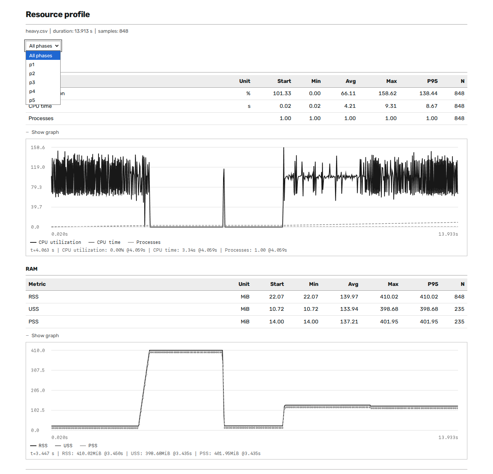
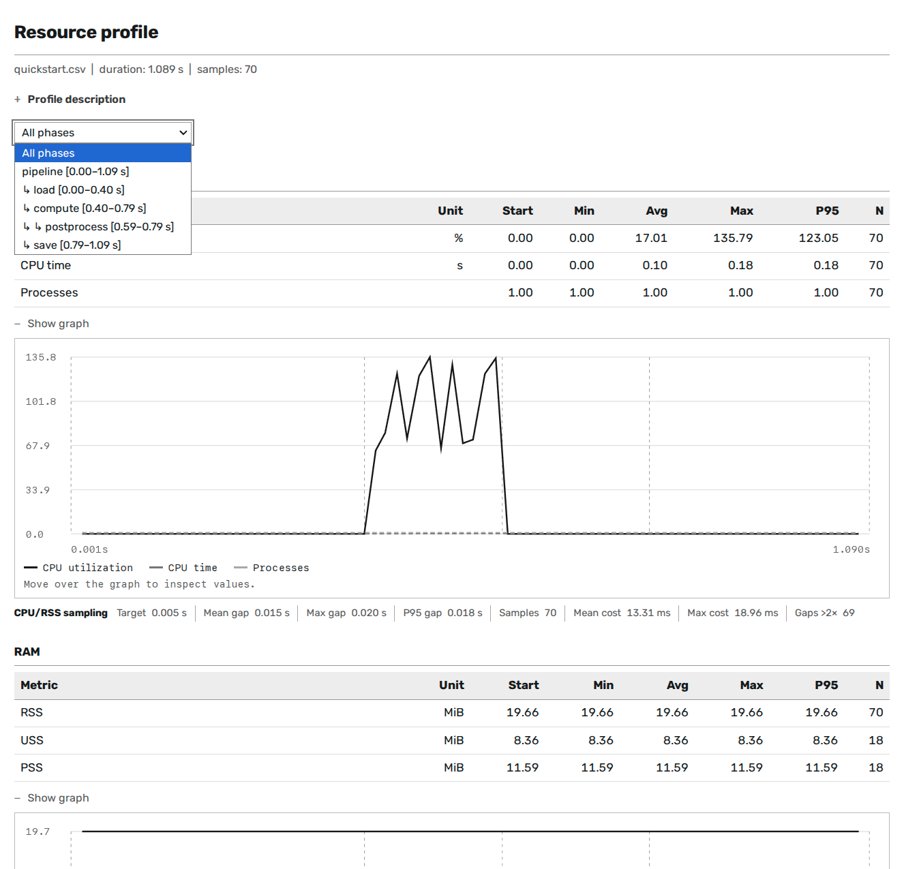

# nprof -- naive profiler
Последняя актуальная версия: 0.6.1  

`nprof` -- это статистический python-профайлер ресурсов процесса и его дочерних процессов: CPU, RAM, GPU  
`nprof` не является function-level профайлером: он измеряет потребление ресурсов по времени, а не вызовы и строки Python-кода  

На выходе получаются сырые .csv, .json, или форматированные .txt, .md, [.html](#Примеры)

## Установка

Python 3.9+:

```bash
# .whl можно взять из releases
uv add ./nprof-0.3.0-py3-none-any.whl
# выведет доступные для профилирования GPU, win поддерживает только nvidia,
# на linux есть поддержка intel
uv run nprof gpus  
```

## Зависимости:
`psutil`, `nvidia-ml-py`  
Если нужны Intel GPU-метрики на Linux, требуется `intel_gpu_top` в системе. GPU можно полностью отключить: `gpu="none"`  

## Быстрый старт  

```python
# Вы можете найти этот код здесь: examples/quickstart.py
import time

from nprof import phase, profiling_start, profiling_stop, start, stop

profiling_start(
    output="out/quickstart",
    interval=0.005,         # CPU + RSS: 5 мс
    memory_interval=0.05,   # USS + PSS: 50 мс
    gpu_interval=0.1,       # GPU:       100 мс
    gpu="none",             # можно попробовать "auto" для первого доступного GPU
    include_children=True,
    sampler="process",      # также поддерживается thread, но настоятельно рекомендуется именно process
    html=True,
    description="## Быстрый старт. Здесь могут быть версии драйверов и ПО, параметры тестируемого кода, дата и время, etc",
)

try:
    start()                         # начало интересующего окна
    try:
        with phase("pipeline"):     # phase работают инклюзивно: включают в себя вложенные интервалы
            with phase("load"):
                time.sleep(0.4)
            with phase("compute"):
                result = sum(i*i for i in range(4_000_000))
                with phase("postprocess"):
                    time.sleep(0.2)
            with phase("save"):
                time.sleep(0.3)
    finally:
        stop()                       # конец окна
finally:
    report = profiling_stop()        # остановить сборщик и записать отчёты

print(report["selection"]["duration_s"])
print(report["phase_summaries"]["pipeline"]["metrics"]["rss_mib"]["max"])
```
В результате будут созданы файлы quickstart.csv, .txt, [.html](#Примеры)  
Файл .html полностью автономный и включает в себя удобные для восприятия графики, можно смотреть графики каждой фазы профиля отдельно. 

### API

- `profiling_start(output="results",interval=0.1,gpu="auto",include_children=True,html=True,json=False,md=False,*,description=None,description_file=None,sampler="thread",memory_interval=None,gpu_interval=None)`: запускает профайлер и **блокирует выполнение до получения первых данных** `memory_interval=None` и `gpu_interval=None` наследуют значение `interval`.
- `profiling_stop() -> dict`: останавливает профайлинг, сохраняет результаты и возвращает summary как словарь.
- `start()` / `stop()`: задают выбранный для отчёта интервал. Без них берётся вся сессия после готовности профайлера.
- `with phase("name"):`: интервал с входом/выходом, допускает вложенные интервалы и повторяющиеся имена.
- `mark("name")`: начинает именованный сегмент, следующий `mark(...)` заканчивает предыдущий. `mark("unmarked")` отключает текущую разметку.
- `list_gpus()`: список GPU и бэкендов, CLI-эквивалент `nprof gpus`.

### Про частоту сбора метрик
Некоторые метрики (CPU/RSS) можно собрать много раз в секунду без проблем (допустим, каждые 20мс, т.е. `0.02`s), в то время как другие (GPU/USS/PSS) собирать так часто просто не получится, например, intel_gpu_top обновляет данные только каждые 500мс.  
Интервалы я рекомендую подбирать индивидуально, они независимы и в .html вы сможете увидеть насколько фактические интервалы измерений соответствуют целевым, например, вы можете увидеть что-то такое:  
`CPU/RSS sampling | Target 0.010 s | Mean gap 0.015 s Max gap 0.047 s | P95 gap 0.031 s | Samples 952 | Mean cost 6.66 ms | Max cost 47.00 ms`,  
здесь видно что вместо желаемого интервала 10мс я получил средний 15мс

### Форматы

| Формат | Что содержит |
| --- | --- |
| `.csv` | CPU/RSS выборки выбранного окна с разреженными USS/PSS/GPU-значениями; отдельные временные метки для медленных метрик |
| `.json` | Метаданные прогона, события, границы фаз, inclusive-сводки, sampling quality |
| `.txt` | Человекочитаемые таблицы и список выборок |
| `.md` | Markdown-таблицы для документации |
| `.html` | Автономные графики и интерактивная навигация по фазам |

### Собираемые метрики

| Метрика | Значение |
| --- | --- |
| `cpu_pct` | Загрузка отслеживаемых процессов: **100% — одно полностью занятое логическое ядро**; значение может быть выше 100% |
| `cpu_time_s` | **Накопленное CPU-время от базовой выборки выбранного окна**, учитывающее уже измеренное CPU-время завершившихся дочерних процессов; не абсолютное CPU-время жизни процесса |
| `rss_mib` | Сумма RSS, разделяемая память может быть посчитана несколько раз |
| `uss_mib`, `pss_mib` | Доступные через `psutil` показатели памяти процессов |
| `process_count` | Количество наблюдаемых отслеживаемых процессов в выборке |
| `gpu_device_*` | GPU-wide метрики всего устройства, **содержат чужую нагрузку** |
| `gpu_process_vram_mib` | VRAM наблюдаемых NVIDIA/Intel compute-процессов, если доступно |
| `sample_duration_ms` | Сколько занимал полный цикл одной выборки (включая медленные измерения, если они были) |
| `memory_elapsed_s`, `gpu_elapsed_s` | Отдельные временные метки для редких USS/PSS и GPU-измерений |
| `memory_sample_duration_ms`, `gpu_sample_duration_ms` | Стоимость конкретного дорогого запроса, будет пустым, если он не выполнялся |

## CLI и HTML

Также есть CLI, он прост как логическая цепочка сократа

```bash
uv run nprof gpus # отобразит список доступных для профайлинга GPU
uv run nprof view results.csv  # создаст .html отчет из .csv исходника
uv run nprof view results.csv --open # также сразу откроет этот отчет в браузере по умолчанию
uv run nprof view results.csv --html # тоже создаст .html отчет из .csv исходника
uv run nprof view results.csv --no-html --md # создаст .md
```

### Примеры
[.txt](docs/preview/heavy.txt), [.csv](docs/preview/heavy.csv), [.md](docs/preview/heavy.md), [.json](docs/preview/heavy.json), [.html](docs/preview/heavy.html)

#### Превью файлов html, получающихся из примеров /examples/





# License

Note that code is licensed under MPL 2.0
